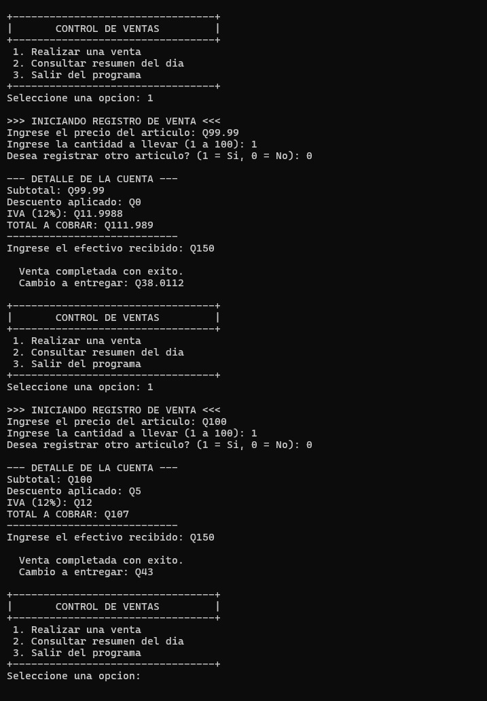
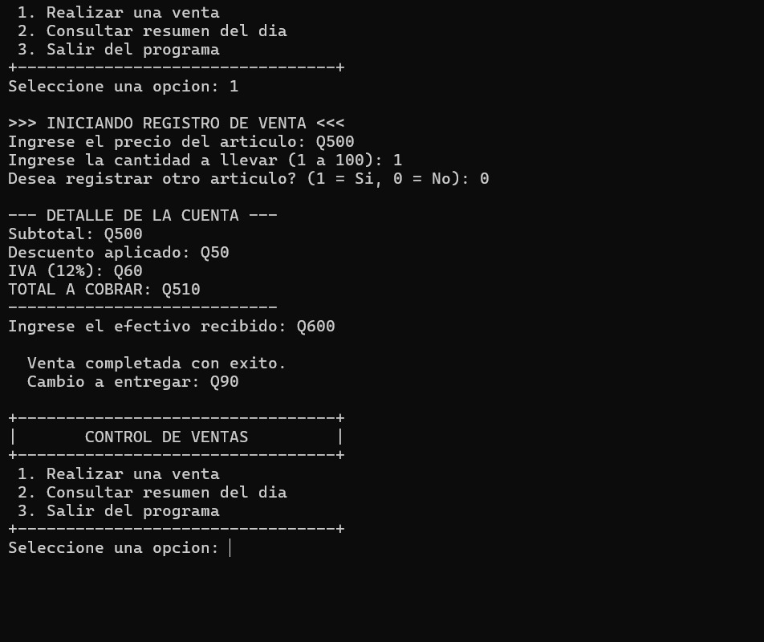
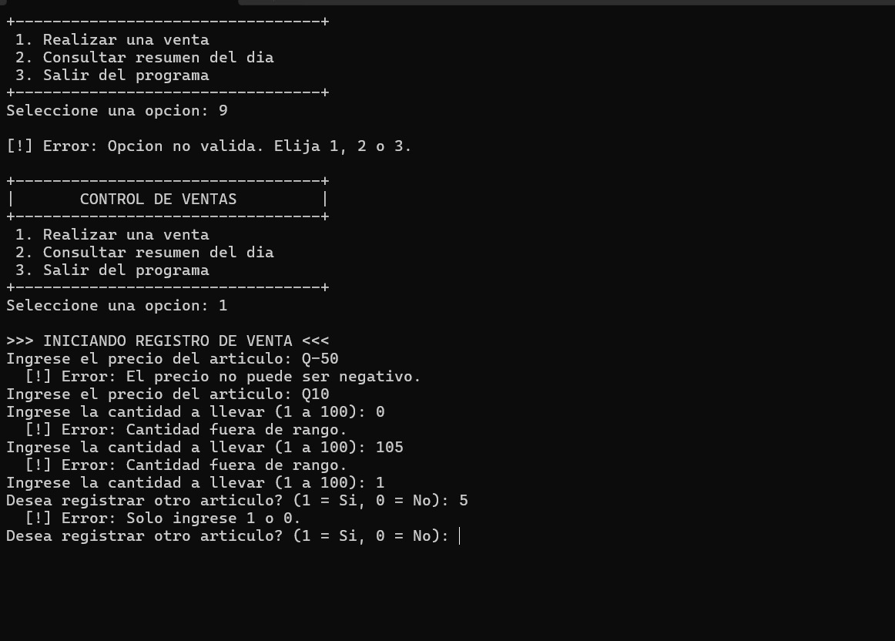
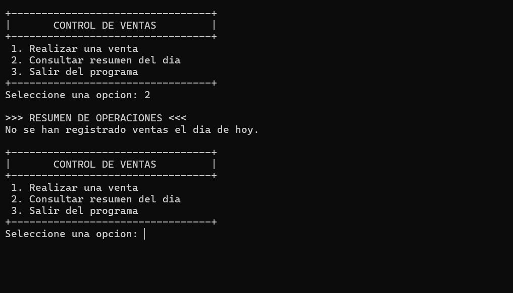
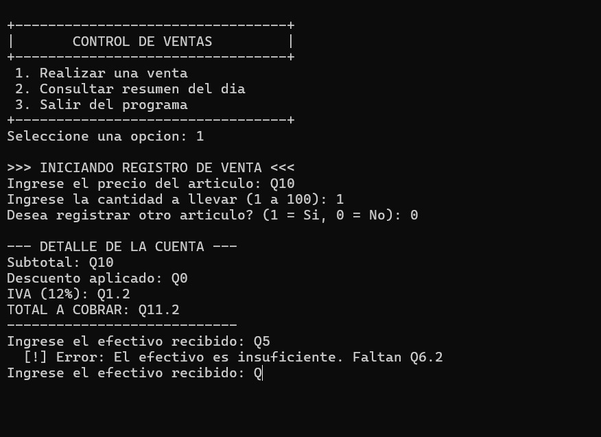

# Registro y Control de Ventas (Caja Registradora)

## Descripción del Proyecto
Este es un programa desarrollado en C++ diseñado para gestionar las transacciones diarias de un comercio. El sistema permite el ingreso de múltiples artículos por cliente, calcula de forma automática los descuentos aplicables según el volumen de compra, suma el Impuesto al Valor Agregado (IVA) y mantiene un registro del efectivo en caja, así como de la venta más alta y más baja del día.

## Instrucciones de Compilación y Ejecución
Para hacer funcionar este programa, se requiere un entorno de desarrollo compatible con C++ (como Visual Studio, Code::Blocks, o un compilador GCC/MinGW).

*Desde la terminal:*
1. Navegue hasta la carpeta donde se encuentra el código fuente.
2. Compile el archivo ejecutando el comando: 
   g++ main.cpp -o sistema_ventas.exe
3. Ejecute el programa con: 
   ./sistema_ventas.exe

## Estructuras de Control y Lógica Implementada

A diferencia de un flujo lineal, este sistema utiliza una arquitectura basada en ciclos para mantener la ejecución viva y validar cada dato ingresado:

*   *Menú Principal (do-while y switch):* El esqueleto del programa es un ciclo do-while que muestra la interfaz y captura la elección del usuario. La decisión se procesa a través de una estructura switch con casos específicos para Vender, Ver Resumen o Salir.
*   *Ingreso de Productos (while):* El proceso de venta está envuelto en un ciclo while que evalúa la variable agregarMas. Esto permite al cajero seguir sumando productos a una misma cuenta hasta que ingrese el número 0.
*   *Validaciones Estrictas (do-while):* Para evitar que el sistema colapse por errores humanos, se implementaron bucles do-while en las entradas críticas. El programa no avanzará si se detecta un precio negativo, una cantidad irreal (menor a 1 o mayor a 100), o si el efectivo entregado por el cliente es menor al total a cobrar.
*   *Cálculo de Descuentos (if / else if):* Al finalizar la cuenta, el flujo pasa por un bloque condicional que evalúa el subtotal. Si la compra es igual o superior a Q500, aplica un 10%; si es mayor o igual a Q100, aplica un 5%.

## Uso de la IA
Durante el desarrollo del proyecto "Sistema de Caja para una Tienda", se utilizó inteligencia artificial como herramienta de apoyo en la elaboración y revisión del código en C++.

La IA brindó asistencia para estructurar partes del programa, implementar las validaciones de datos, calcular los descuentos y el IVA, y resolver dudas relacionadas con el funcionamiento de las instrucciones y estructuras de control.

Posteriormente, el programa fue compilado y ejecutado en Visual Studio Code, donde se realizaron pruebas con diferentes valores para comprobar los cálculos, la gestión de ventas y la detección de entradas incorrectas.

El uso de esta herramienta permitió avanzar en el desarrollo del sistema y reforzar la comprensión práctica de los temas estudiados durante el curso.
## Casos de Prueba (Evidencia de Ejecución)

En esta sección se documenta el correcto funcionamiento del sistema ante diferentes escenarios.

### Prueba A: Transacciones Regulares y Límite de 5%
> Se verifica una compra que no aplica a descuento (ej. Q99.99) y otra que alcanza exactamente el límite para aplicar el 5% (Q100.00).

### Prueba B: Aplicación de Descuento Máximo (10%)
> Se comprueba que el programa calcule y reste el 10% de descuento al alcanzar un subtotal de Q500.00 o más.
[Insertar la imagen del Caso 2 aquí usando el formato: ]

### Prueba C: Manejo de Datos Inválidos
> Demostración de las barreras de seguridad. El sistema debe rechazar cantidades en 0, ingresos superiores a 100 unidades y precios con números negativos.
[Insertar la imagen del Caso 3 aquí usando el formato: ]

### Prueba D: Resumen del Día en Blanco
> Se verifica el comportamiento de la opción 2 del menú cuando se solicita un corte de caja sin haber registrado ventas previas.
[Insertar la imagen del Caso 4 aquí usando el formato: ]

### Prueba E: Bloqueo por Pago Insuficiente
> Se valida que el sistema impida finalizar la venta si el monto ingresado como pago por el cliente es menor al total a cobrar.
[Insertar la imagen del Caso 5 aquí usando el formato: ]
>
## Video de demostración del proyecto

En el siguiente video se presenta el funcionamiento del Sistema de Caja desarrollado en C++, incluyendo la explicación del código y las pruebas realizadas.

**Enlace del video:** https://youtu.be/X8UO1Gn4oXs
